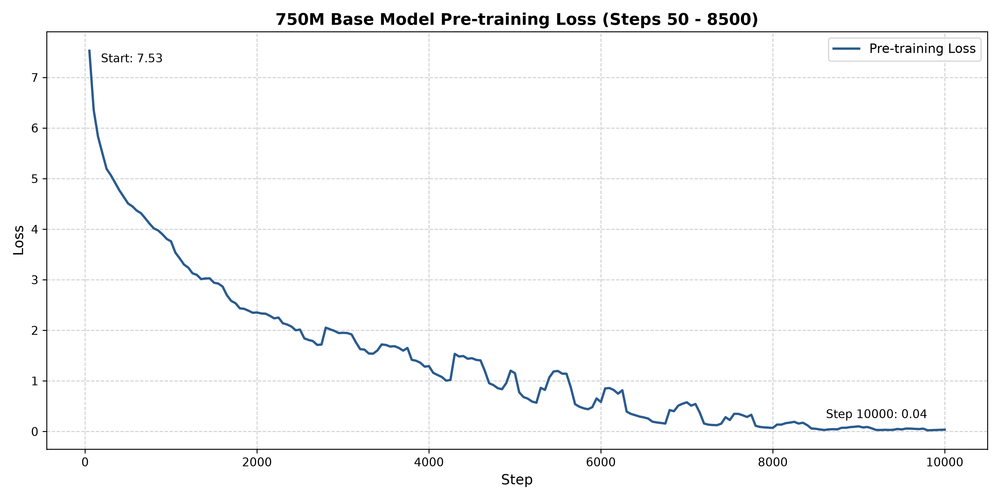

# Foundation SLM & Godot Domain Adaptation Pipeline

This repository contains the full machine learning pipeline for engineering a 750-million-parameter Small Language Model (SLM) from scratch, followed by domain-specific fine-tuning using Low-Rank Adaptation (LoRA) for the Godot 4 API and GDScript.

The core objective is to pre-train a highly efficient foundational model on C++ and Python syntax, and subsequently prove domain adaptability by teaching the model a specific game engine API. The final model is quantized for CPU-only inference.

## Architecture Specifications

### Base Model (692M)

- **Context Window:** 8,192 tokens
- **Positional Encoding:** Rotary Position Embeddings (RoPE)
- **Attention Mechanism:** Grouped Query Attention (GQA)
- **Tokenizer:** Custom Byte-Pair Encoding (BPE), vocabulary size 32,000

### Domain Adaptation (LoRA)

- **Target Modules:** Attention block query and value projections (`q_proj`, `v_proj`)
- **Parameters:** Rank (r) = 16, Alpha = 32
- **Precision:** NF4 Base (frozen), bfloat16 Adapters

## Execution Pipeline

The project is divided into sequentially numbered execution scripts located in the `scripts/` directory.

1. **`01_stream_and_tokenize.py`**: Streams language-filtered data from `bigcode/the-stack-v2-dedup` and trains the BPE tokenizer.
2. **`02_train_base_model.py`**: Initializes the custom Llama-style architecture and runs the pre-training loop.
3. **`03_scrape_godot_docs.py`**: Extracts and formats Godot 4 API documentation into JSONL instruction pairs.
4. **`04_train_lora.py`**: Merges the instruction dataset with the frozen base model to train the LoRA weights.
5. **`05_inference_cpu.py`**: Executes the GGUF quantized model via `llama.cpp` for local, CPU-bound terminal interaction.

## Environment Setup

Create a virtual environment and install the required dependencies:

```bash
python -m venv slm_env
source slm_env/bin/activate  # On Windows: slm_env\Scripts\activate
pip install -r requirements.txt
huggingface-cli login
```

## Model Loss Graph

<!--  -->


## License

This project is licensed under the MIT License.
